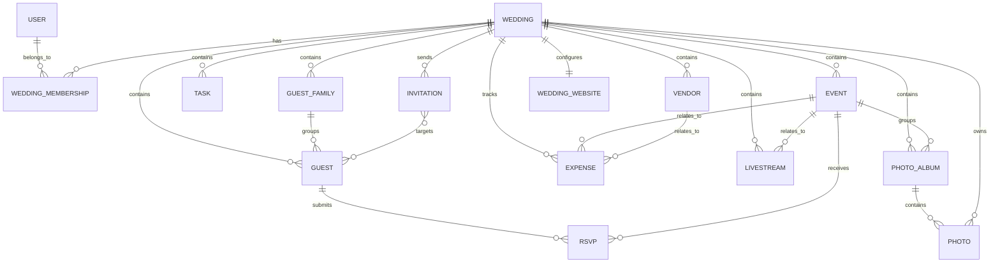
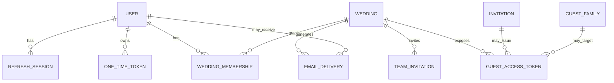

**Make My Marriage**

**Database Design Document**

**MVP V1**

| **Database**     | MongoDB Atlas                                          |
|------------------|--------------------------------------------------------|
| **ODM**          | Mongoose                                               |
| **Architecture** | Modular monolith / wedding-scoped multi-tenancy        |
| **Status**       | Approved architecture baseline - implementation design |

| **Purpose** Define the MongoDB data model for Make My Marriage MVP V1 so backend implementation can proceed with consistent collections, references, indexes, validation rules, security boundaries, and lifecycle behavior. |
|------------------------------------------------------------------------------------------------------------------------------------------------------------------------------------------------------------------------------|

# Contents

1\. Executive Summary

2\. Design Goals and Database Principles

3\. Technology and Data Conventions

4\. Multi-Tenancy and Ownership Model

5\. Collection Inventory

6\. Relationship Model

7\. Embedding vs Referencing Strategy

8\. Detailed Collection Designs

9\. Index Strategy

10\. Integrity and Business Constraints

11\. Authentication and Token Data

12\. Guest Access and RSVP Modeling

13\. Money and Expense Modeling

14\. Media and Photo Metadata

15\. Soft Delete, Retention, and Purge

16\. Transactions and Concurrency

17\. Query Patterns

18\. Security and Data Protection

19\. Mongoose Implementation Conventions

20\. Migration and Schema Evolution

21\. Backup and Recovery Considerations

22\. Future Scaling

23\. Implementation Order

24\. Final Database Decision Summary

# 1. Executive Summary

Make My Marriage V1 will use MongoDB Atlas with Mongoose. The database is designed as a wedding-scoped multi-tenant model: a User may belong to many weddings through WeddingMembership, while nearly every operational document is owned by a wedding through weddingId.

The model intentionally avoids oversized embedded Wedding documents. Events, tasks, guests, invitations, RSVPs, expenses, vendors, website settings, livestreams, albums, photos, and email delivery records live in focused collections. Small, bounded subdocuments are embedded only when they belong exclusively to one parent and do not need independent querying.

| **Core rule** Every authenticated wedding operation must resolve a WeddingMembership and every wedding-owned query must be scoped by weddingId. Public guest flows use hashed opaque capability tokens, never MongoDB IDs as authorization. |
|---------------------------------------------------------------------------------------------------------------------------------------------------------------------------------------------------------------------------------------------|

# 2. Design Goals and Database Principles

- Keep the V1 schema simple enough for one modular-monolith backend while preserving clear domain boundaries.

- Support one user participating in multiple weddings with different roles.

- Use weddingId as the tenant/data-isolation boundary on operational collections.

- Favor references for growing or independently queried data; embed only bounded value objects.

- Avoid duplicated derived state where it can drift (for example, RSVP pending is derived from missing RSVP rows).

- Store money as integer paise, not floating-point rupee values.

- Store timestamps as UTC Date values and display them using the wedding timezone.

- Never persist raw passwords, refresh tokens, verification tokens, manager-invite tokens, or guest access tokens.

- Design compound indexes around real V1 query patterns, usually beginning with weddingId.

- Keep S3 object bytes outside MongoDB; MongoDB stores only media metadata and object keys.

# 3. Technology and Data Conventions

| **Area**         | **Decision**                       | **Convention**                                                                                  |
|------------------|------------------------------------|-------------------------------------------------------------------------------------------------|
| Primary database | MongoDB Atlas                      | Managed cluster; application connects through Mongoose.                                         |
| IDs              | ObjectId                           | Internal entity references use ObjectId. Public access never relies on guessable ObjectId URLs. |
| Time             | UTC Date                           | Wedding.timezone defaults to Asia/Kolkata and controls display/business interpretation.         |
| Currency         | INR in V1                          | Money fields are integer paise (for example, Rs 1,500.50 = 150050).                             |
| Email            | Normalized lowercase               | Store display email if needed, but query/unique on emailNormalized.                             |
| Enums            | Upper snake case                   | Examples: ADMIN, MANAGER, IN_PROGRESS, APPROVED.                                                |
| Audit timestamps | createdAt / updatedAt              | Mongoose timestamps enabled on durable collections.                                             |
| Soft delete      | deletedAt                          | Used where recovery/reference preservation matters; null means active.                          |
| Tokens           | Random opaque value + SHA-256 hash | Raw token is sent to client/email once; only tokenHash is stored.                               |
| Media URLs       | Derived                            | Store S3 key/path; do not persist environment-specific CloudFront URLs as primary data.         |

## Reusable value objects

| **Value object** | **Suggested shape**                                                       | **Used by**                                   |
|------------------|---------------------------------------------------------------------------|-----------------------------------------------|
| Location         | addressText, city, state, postalCode, country, googlePlaceId?, lat?, lng? | Wedding, Event, Vendor                        |
| MediaRef         | s3Key, mimeType, sizeBytes, width?, height?                               | Wedding couple/cover image, Event cover image |
| Actor audit      | createdByMembershipId?, updatedByMembershipId?                            | Key mutable wedding resources                 |
| Money            | integer paise                                                             | Expense totals and paid amounts               |

# 4. Multi-Tenancy and Ownership Model

A wedding is the tenant/workspace. User is a global account identity. WeddingMembership links the two and owns the role. This avoids placing ADMIN or MANAGER on the User itself.

<table>
<colgroup>
<col style="width: 100%" />
</colgroup>
<thead>
<tr class="header">
<th>User A ── WeddingMembership(ADMIN) ── Wedding 1 
└── WeddingMembership(MANAGER) ─ Wedding 2 
 
User.role -&gt; not used 
WeddingMembership.role -&gt; ADMIN | MANAGER 
Operational record ownership -&gt; weddingId</th>
</tr>
</thead>
<tbody>
</tbody>
</table>

- Every protected request validates the authenticated user, resolves an ACTIVE WeddingMembership for the requested weddingId, then applies the ADMIN/MANAGER rule.

- ADMIN-only team-management operations check role === ADMIN.

- Managers retain full operational access but cannot manage memberships.

- Removed memberships are retained as historical records so tasks/audit fields can still reference the person who previously participated.

- The “at least one Admin” rule cannot be expressed as a simple MongoDB unique constraint; it is enforced transactionally in the service layer.

# 5. Collection Inventory

| **Collection**     | **Purpose**                                    | **Scope**    |
|--------------------|------------------------------------------------|--------------|
| users              | Global authenticated account                   | Global       |
| refreshSessions    | Rotating JWT refresh-session chain             | User         |
| oneTimeTokens      | Email verification and password-reset tokens   | User         |
| weddings           | Wedding workspace/root aggregate               | Wedding      |
| weddingMemberships | User-to-wedding role/access link               | Wedding      |
| teamInvitations    | Pending Manager invitations                    | Wedding      |
| events             | Wedding ceremonies/functions                   | Wedding      |
| tasks              | Planning tasks                                 | Wedding      |
| guestFamilies      | Household grouping                             | Wedding      |
| guests             | Individual invitees                            | Wedding      |
| invitations        | Digital invitation recipient grouping/state    | Wedding      |
| guestAccessTokens  | Public capability tokens for RSVP/photo upload | Wedding      |
| rsvps              | One guest + event attendance response          | Wedding      |
| expenses           | Expense tracker records                        | Wedding      |
| vendors            | My Vendors records                             | Wedding      |
| weddingWebsites    | Public site config/theme/slug                  | Wedding      |
| livestreams        | External YouTube stream metadata               | Wedding      |
| photoAlbums        | Event/custom album metadata                    | Wedding      |
| photos             | S3 object metadata and moderation state        | Wedding      |
| emailDeliveries    | Durable email send/delivery state              | User/Wedding |

| **Intentionally absent** There is no Budget collection, Role collection, GuestAccount collection, VendorAccount collection, or image-binary collection in V1. |
|---------------------------------------------------------------------------------------------------------------------------------------------------------------|

# 6. Relationship Model

The diagram below shows the core planning/guest/media relationships. Arrows represent references rather than embedded unbounded child arrays.

Security/session/public-token records are intentionally separated from business entities:

# 7. Embedding vs Referencing Strategy

| **Relationship**                       | **Decision**                | **Reason**                                                                  |
|----------------------------------------|-----------------------------|-----------------------------------------------------------------------------|
| Wedding -\> Events/Tasks/Guests/Photos | Reference by weddingId      | These collections grow and need independent filtering/pagination.           |
| GuestFamily -\> Guests                 | Guest.familyId reference    | Avoid duplicate member arrays and bidirectional update drift.               |
| Guest -\> invited events               | Embed invitedEventIds\[\]   | Number of wedding events is small and bounded; frequent guest-centric read. |
| Vendor -\> events                      | Embed eventIds\[\]          | Small bounded association; simplifies vendor UI.                            |
| Invitation -\> recipient guests        | Embed guestIds\[\] snapshot | Household size is bounded; preserves the invitation recipient set.          |
| RSVP                                   | Separate collection         | Needs guest/event uniqueness, filtering, aggregates, and updates.           |
| Wedding/Event images                   | Embed MediaRef              | One/few bounded image references; not gallery photos.                       |
| Gallery photos                         | Separate Photo collection   | Potentially thousands of records, pagination and moderation required.       |
| Location                               | Embedded value object       | Belongs to one parent and does not need independent lifecycle.              |
| Email delivery                         | Separate collection         | Independent retry/provider-event lifecycle and auditability.                |

# 8. Detailed Collection Designs

The fields below are the implementation baseline. Optional audit fields may be added consistently by shared Mongoose plugins/helpers, but V1 should avoid ad-hoc fields outside this contract.

## 8.1. users

Stores authenticated user identity. Roles do not live on User; access is wedding-specific through WeddingMembership.

### Fields

| **Field**             | **Type** | **Req.** | **Design notes**                                              |
|-----------------------|----------|----------|---------------------------------------------------------------|
| \_id                  | ObjectId | Y        | Primary key.                                                  |
| name                  | String   | Y        | Display name; trim; reasonable max length.                    |
| email                 | String   | Y        | Original/display email.                                       |
| emailNormalized       | String   | Y        | Lowercase normalized email used for login/uniqueness.         |
| passwordHash          | String   | Y        | Argon2id hash; never returned by normal queries.              |
| emailVerifiedAt       | Date     | N        | Null until successful email verification.                     |
| status                | Enum     | Y        | ACTIVE \| DELETED.                                            |
| deletedAt             | Date     | N        | Set during account soft deletion after last-admin safeguards. |
| createdAt / updatedAt | Date     | Y        | Mongoose timestamps.                                          |

### Indexes

| **Index**              | **Type** | **Reason**                                 |
|------------------------|----------|--------------------------------------------|
| { emailNormalized: 1 } | UNIQUE   | One account per normalized email.          |
| { status: 1 }          | NORMAL   | Operational/support filtering if required. |

### Rules

- Do not place ADMIN/MANAGER role on User.

- Authentication queries should explicitly select passwordHash only when needed.

- Account deletion is blocked if the user is the last Admin of any active wedding.

### Example document

<table>
<colgroup>
<col style="width: 100%" />
</colgroup>
<thead>
<tr class="header">
<th>{ 
"_id": "ObjectId(...)", 
"name": "Yogesh Kasliwal", 
"email": "yogesh@example.com", 
"emailNormalized": "yogesh@example.com", 
"passwordHash": "&lt;argon2id hash&gt;", 
"emailVerifiedAt": "2026-10-08T08:10:00Z", 
"status": "ACTIVE" 
}</th>
</tr>
</thead>
<tbody>
</tbody>
</table>

## 8.2. refreshSessions

Persists rotating refresh-token sessions so logout, revocation, token-reuse detection, and “logout all devices” can be implemented securely.

### Fields

| **Field**             | **Type**    | **Req.** | **Design notes**                                          |
|-----------------------|-------------|----------|-----------------------------------------------------------|
| \_id                  | ObjectId    | Y        | Refresh-token instance/session record.                    |
| userId                | ObjectId    | Y        | Ref -\> users.                                            |
| familyId              | String/UUID | Y        | Groups the rotation chain for one login/device session.   |
| tokenHash             | String      | Y        | SHA-256 of the opaque refresh token/JTI; never raw token. |
| status                | Enum        | Y        | ACTIVE \| ROTATED \| REVOKED.                             |
| replacedBySessionId   | ObjectId    | N        | Ref -\> refreshSessions created during rotation.          |
| userAgent             | String      | N        | Limited length; useful for session display/debugging.     |
| expiresAt             | Date        | Y        | Hard application expiry and TTL cleanup target.           |
| revokedAt             | Date        | N        | Set on logout/reuse detection.                            |
| createdAt / updatedAt | Date        | Y        | Timestamps.                                               |

### Indexes

| **Index**                | **Type**                 | **Reason**                                                |
|--------------------------|--------------------------|-----------------------------------------------------------|
| { tokenHash: 1 }         | UNIQUE                   | Fast secure refresh-token lookup.                         |
| { userId: 1, status: 1 } | NORMAL                   | Session management/revoke-all.                            |
| { familyId: 1 }          | NORMAL                   | Revoke an entire rotation chain on reuse.                 |
| { expiresAt: 1 }         | TTL expireAfterSeconds=0 | Automatic stale-session cleanup; app still checks expiry. |

### Rules

- On successful rotation, mark old session ROTATED and create a new ACTIVE session in the same family.

- If a ROTATED token is reused, revoke all ACTIVE sessions in that family.

- Never log tokenHash or raw refresh token.

## 8.3. oneTimeTokens

Stores short-lived one-time authentication tokens for email verification and password reset.

### Fields

| **Field** | **Type** | **Req.** | **Design notes**                               |
|-----------|----------|----------|------------------------------------------------|
| \_id      | ObjectId | Y        | Primary key.                                   |
| userId    | ObjectId | Y        | Ref -\> users.                                 |
| type      | Enum     | Y        | EMAIL_VERIFICATION \| PASSWORD_RESET.          |
| tokenHash | String   | Y        | SHA-256 of cryptographically random raw token. |
| expiresAt | Date     | Y        | Purpose-specific expiry.                       |
| usedAt    | Date     | N        | Set on successful consumption.                 |
| createdAt | Date     | Y        | Creation timestamp.                            |

### Indexes

| **Index**              | **Type**                 | **Reason**                                   |
|------------------------|--------------------------|----------------------------------------------|
| { tokenHash: 1 }       | UNIQUE                   | Token lookup.                                |
| { userId: 1, type: 1 } | NORMAL                   | Invalidate earlier active tokens if desired. |
| { expiresAt: 1 }       | TTL expireAfterSeconds=0 | Cleanup expired tokens.                      |

### Rules

- Expiry and usedAt must be checked in application code; TTL deletion is not guaranteed to happen at the exact expiry second.

- Generating a new password-reset token should invalidate older usable reset tokens for the user.

## 8.4. weddings

Root wedding workspace. Contains bounded wedding profile/configuration data, not operational child arrays.

### Fields

| **Field**             | **Type** | **Req.** | **Design notes**                                   |
|-----------------------|----------|----------|----------------------------------------------------|
| \_id                  | ObjectId | Y        | Primary key / tenant id.                           |
| brideName             | String   | Y        | Bride display name.                                |
| groomName             | String   | Y        | Groom display name.                                |
| title                 | String   | Y        | Wedding display title.                             |
| weddingDate           | Date     | Y        | Primary wedding date stored in UTC representation. |
| timezone              | String   | Y        | Default Asia/Kolkata.                              |
| currency              | String   | Y        | INR for V1.                                        |
| location              | Location | N        | Primary wedding location value object.             |
| description           | String   | N        | Short wedding description.                         |
| expectedGuestCount    | Number   | N        | Non-negative integer.                              |
| coupleImage           | MediaRef | N        | S3 key + metadata.                                 |
| coverImage            | MediaRef | N        | S3 key + metadata.                                 |
| createdByUserId       | ObjectId | Y        | Creator identity; first membership becomes ADMIN.  |
| deletedAt             | Date     | N        | Soft-delete marker.                                |
| createdAt / updatedAt | Date     | Y        | Timestamps.                                        |

### Indexes

| **Index**                            | **Type** | **Reason**                                                  |
|--------------------------------------|----------|-------------------------------------------------------------|
| { createdByUserId: 1, deletedAt: 1 } | NORMAL   | Creator/admin listing and support.                          |
| { weddingDate: 1 }                   | NORMAL   | Optional operations/support ordering; not an auth boundary. |

### Rules

- Wedding creation and first ADMIN membership are created in one transaction.

- No fixed total budget field in V1.

- Deleting a wedding is soft delete; child records remain inaccessible because parent wedding is deleted.

### Example document

<table>
<colgroup>
<col style="width: 100%" />
</colgroup>
<thead>
<tr class="header">
<th>{ 
"title": "Yogesh &amp; Priya", 
"weddingDate": "2027-02-12T00:00:00Z", 
"timezone": "Asia/Kolkata", 
"currency": "INR", 
"location": { "city": "Pune", "state": "Maharashtra", "country": "IN" }, 
"deletedAt": null 
}</th>
</tr>
</thead>
<tbody>
</tbody>
</table>

## 8.5. weddingMemberships

Authoritative user-to-wedding access record. It carries ADMIN/MANAGER role and preserves historical membership identity.

### Fields

| **Field**             | **Type** | **Req.** | **Design notes**                                 |
|-----------------------|----------|----------|--------------------------------------------------|
| \_id                  | ObjectId | Y        | Membership id; useful for task assignment/audit. |
| weddingId             | ObjectId | Y        | Ref -\> weddings.                                |
| userId                | ObjectId | Y        | Ref -\> users.                                   |
| role                  | Enum     | Y        | ADMIN \| MANAGER.                                |
| status                | Enum     | Y        | ACTIVE \| REMOVED.                               |
| joinedAt              | Date     | Y        | First/most recent activation time.               |
| removedAt             | Date     | N        | Set when access removed.                         |
| createdAt / updatedAt | Date     | Y        | Timestamps.                                      |

### Indexes

| **Index**                            | **Type** | **Reason**                                        |
|--------------------------------------|----------|---------------------------------------------------|
| { weddingId: 1, userId: 1 }          | UNIQUE   | One durable membership identity per user/wedding. |
| { userId: 1, status: 1 }             | NORMAL   | List weddings available to a user.                |
| { weddingId: 1, role: 1, status: 1 } | NORMAL   | Team list and Admin safeguard checks.             |

### Rules

- Removing a Manager changes status to REMOVED instead of deleting the document. Re-inviting can reactivate the same record.

- Role changes apply only to ACTIVE membership.

- A transaction must prevent demotion/removal if it would leave zero ACTIVE ADMIN memberships.

### Example document

<table>
<colgroup>
<col style="width: 100%" />
</colgroup>
<thead>
<tr class="header">
<th>{ 
"weddingId": "ObjectId(w1)", 
"userId": "ObjectId(u1)", 
"role": "ADMIN", 
"status": "ACTIVE", 
"joinedAt": "2026-10-08T09:00:00Z" 
}</th>
</tr>
</thead>
<tbody>
</tbody>
</table>

## 8.6. teamInvitations

Tracks Admin-created invitations for a person to join a wedding as Manager.

### Fields

| **Field**             | **Type** | **Req.** | **Design notes**                                                |
|-----------------------|----------|----------|-----------------------------------------------------------------|
| \_id                  | ObjectId | Y        | Primary key.                                                    |
| weddingId             | ObjectId | Y        | Ref -\> weddings.                                               |
| email                 | String   | Y        | Recipient display email.                                        |
| emailNormalized       | String   | Y        | Normalized lookup/deduplication.                                |
| role                  | Enum     | Y        | MANAGER in V1; ADMIN promotion happens after membership exists. |
| tokenHash             | String   | Y        | Hashed one-time invitation token.                               |
| status                | Enum     | Y        | PENDING \| ACCEPTED \| REVOKED \| EXPIRED.                      |
| invitedByMembershipId | ObjectId | Y        | Ref -\> ACTIVE ADMIN membership.                                |
| expiresAt             | Date     | Y        | Invitation expiry.                                              |
| acceptedByUserId      | ObjectId | N        | Set on acceptance.                                              |
| acceptedAt            | Date     | N        | Acceptance time.                                                |
| createdAt / updatedAt | Date     | Y        | Timestamps.                                                     |

### Indexes

| **Index**                                       | **Type** | **Reason**                                           |
|-------------------------------------------------|----------|------------------------------------------------------|
| { tokenHash: 1 }                                | UNIQUE   | Invitation-link lookup.                              |
| { weddingId: 1, emailNormalized: 1, status: 1 } | NORMAL   | Prevent/locate duplicate pending invitations.        |
| { expiresAt: 1 }                                | NORMAL   | Cleanup/reporting; status also validated explicitly. |

### Rules

- Only an ACTIVE ADMIN can create/revoke team invitations.

- Acceptance transaction creates/reactivates WeddingMembership and marks invitation ACCEPTED.

- Raw invitation token is never stored.

## 8.7. events

Stores wedding ceremonies/functions. Other modules reference Event rather than duplicating event metadata.

### Fields

| **Field**             | **Type** | **Req.** | **Design notes**                         |
|-----------------------|----------|----------|------------------------------------------|
| \_id                  | ObjectId | Y        | Primary key.                             |
| weddingId             | ObjectId | Y        | Tenant owner.                            |
| name                  | String   | Y        | Example: Mehendi.                        |
| description           | String   | N        | Event description.                       |
| startAt               | Date     | Y        | UTC timestamp.                           |
| endAt                 | Date     | N        | Must be \>= startAt.                     |
| venueName             | String   | N        | Venue display name.                      |
| location              | Location | N        | Address/place/location metadata.         |
| dressCode             | String   | N        | Guest-facing text.                       |
| coverImage            | MediaRef | N        | Optional event cover image.              |
| notes                 | String   | N        | Internal/operational notes.              |
| createdByMembershipId | ObjectId | N        | Creator.                                 |
| updatedByMembershipId | ObjectId | N        | Last editor.                             |
| deletedAt             | Date     | N        | Soft-delete recommended once referenced. |
| createdAt / updatedAt | Date     | Y        | Timestamps.                              |

### Indexes

| **Index**                                  | **Type**           | **Reason**                                                   |
|--------------------------------------------|--------------------|--------------------------------------------------------------|
| { weddingId: 1, startAt: 1, deletedAt: 1 } | NORMAL             | Event list/upcoming queries.                                 |
| { weddingId: 1, \_id: 1 }                  | IMPLICIT/PK scoped | Service still includes weddingId in query for tenant safety. |

### Rules

- If an event has RSVPs/photos/expenses, soft delete rather than physical delete.

- Guest-facing schedule uses the Wedding timezone for formatting.

## 8.8. tasks

Wedding planning work assigned to a wedding team member.

### Fields

| **Field**             | **Type** | **Req.** | **Design notes**                             |
|-----------------------|----------|----------|----------------------------------------------|
| \_id                  | ObjectId | Y        | Primary key.                                 |
| weddingId             | ObjectId | Y        | Tenant owner.                                |
| eventId               | ObjectId | N        | Ref -\> events.                              |
| title                 | String   | Y        | Task title.                                  |
| description           | String   | N        | Task details.                                |
| assigneeMembershipId  | ObjectId | N        | Ref -\> weddingMemberships, not global User. |
| dueAt                 | Date     | N        | UTC due timestamp/date.                      |
| priority              | Enum     | Y        | LOW \| MEDIUM \| HIGH \| URGENT.             |
| status                | Enum     | Y        | TODO \| IN_PROGRESS \| COMPLETED.            |
| notes                 | String   | N        | Notes.                                       |
| completedAt           | Date     | N        | Set/cleared when status changes.             |
| createdByMembershipId | ObjectId | N        | Creator.                                     |
| updatedByMembershipId | ObjectId | N        | Last editor.                                 |
| createdAt / updatedAt | Date     | Y        | Timestamps.                                  |

### Indexes

| **Index**                                            | **Type** | **Reason**                           |
|------------------------------------------------------|----------|--------------------------------------|
| { weddingId: 1, status: 1, dueAt: 1 }                | NORMAL   | Dashboard, overdue/upcoming filters. |
| { weddingId: 1, assigneeMembershipId: 1, status: 1 } | NORMAL   | My Tasks.                            |
| { weddingId: 1, eventId: 1 }                         | NORMAL   | Event-specific tasks.                |

### Rules

- Assignee must be an ACTIVE membership of the same wedding at assignment time.

- Removed members may remain referenced by historical tasks; UI can show “Former Manager”.

## 8.9. guestFamilies

Groups household members for invitation and RSVP experience without creating guest accounts.

### Fields

| **Field**             | **Type** | **Req.** | **Design notes**                          |
|-----------------------|----------|----------|-------------------------------------------|
| \_id                  | ObjectId | Y        | Primary key.                              |
| weddingId             | ObjectId | Y        | Tenant owner.                             |
| name                  | String   | Y        | Example: Sharma Family.                   |
| primaryContactGuestId | ObjectId | N        | Ref -\> guests within the same family.    |
| notes                 | String   | N        | Internal notes.                           |
| deletedAt             | Date     | N        | Soft-delete if invitation history exists. |
| createdAt / updatedAt | Date     | Y        | Timestamps.                               |

### Indexes

| **Index**                                  | **Type** | **Reason**               |
|--------------------------------------------|----------|--------------------------|
| { weddingId: 1, name: 1, deletedAt: 1 }    | NORMAL   | Family list/search.      |
| { weddingId: 1, primaryContactGuestId: 1 } | NORMAL   | Optional contact lookup. |

### Rules

- Do not embed a growing members\[\] array; Guest.familyId is the membership source of truth.

- A family name need not be unique because extended families can share surnames.

## 8.10. guests

Stores individual invitees. Guests are not authenticated Users.

### Fields

| **Field**             | **Type**     | **Req.** | **Design notes**                                      |
|-----------------------|--------------|----------|-------------------------------------------------------|
| \_id                  | ObjectId     | Y        | Primary key.                                          |
| weddingId             | ObjectId     | Y        | Tenant owner.                                         |
| familyId              | ObjectId     | N        | Ref -\> guestFamilies.                                |
| fullName              | String       | Y        | Guest display name.                                   |
| email                 | String       | N        | Optional; guest may be invited only by link/WhatsApp. |
| emailNormalized       | String       | N        | Lowercase if email exists; not unique.                |
| phone                 | String       | N        | Optional; normalize to E.164 where possible.          |
| relationship          | String       | N        | Relationship label.                                   |
| side                  | Enum         | N        | BRIDE \| GROOM \| BOTH \| OTHER.                      |
| city                  | String       | N        | Guest city.                                           |
| invitedEventIds       | ObjectId\[\] | Y        | Bounded list of event refs; empty until selected.     |
| notes                 | String       | N        | Internal notes.                                       |
| deletedAt             | Date         | N        | Soft-delete to preserve RSVP/invitation history.      |
| createdAt / updatedAt | Date         | Y        | Timestamps.                                           |

### Indexes

| **Index**                                   | **Type** | **Reason**                                 |
|---------------------------------------------|----------|--------------------------------------------|
| { weddingId: 1, fullName: 1, deletedAt: 1 } | NORMAL   | Guest list/name search.                    |
| { weddingId: 1, familyId: 1, deletedAt: 1 } | NORMAL   | Household member lookup.                   |
| { weddingId: 1, emailNormalized: 1 }        | NORMAL   | Recipient lookup; deliberately non-unique. |
| { weddingId: 1, invitedEventIds: 1 }        | MULTIKEY | Event guest list.                          |

### Rules

- Do not persist a single guest.rsvpStatus field; RSVP is event-specific and lives in rsvps.

- Email/phone are optional and may be shared by household members.

## 8.11. invitations

Represents one guest-facing invitation link, typically for a household but also valid for an individual guest.

### Fields

| **Field**             | **Type**     | **Req.** | **Design notes**                              |
|-----------------------|--------------|----------|-----------------------------------------------|
| \_id                  | ObjectId     | Y        | Primary key.                                  |
| weddingId             | ObjectId     | Y        | Tenant owner.                                 |
| guestFamilyId         | ObjectId     | N        | Household target if applicable.               |
| guestIds              | ObjectId\[\] | Y        | Recipient snapshot; one or more guests.       |
| status                | Enum         | Y        | DRAFT \| QUEUED \| SENT \| FAILED \| REVOKED. |
| sendCount             | Number       | Y        | Starts at 0.                                  |
| lastSentAt            | Date         | N        | Most recent invitation send.                  |
| reminderCount         | Number       | Y        | Manual RSVP reminder count.                   |
| lastReminderAt        | Date         | N        | Most recent reminder.                         |
| createdByMembershipId | ObjectId     | Y        | Admin/Manager creating invitation.            |
| createdAt / updatedAt | Date         | Y        | Timestamps.                                   |

### Indexes

| **Index**                          | **Type** | **Reason**                          |
|------------------------------------|----------|-------------------------------------|
| { weddingId: 1, status: 1 }        | NORMAL   | Invitation dashboard.               |
| { weddingId: 1, guestFamilyId: 1 } | NORMAL   | Household invitation lookup.        |
| { weddingId: 1, guestIds: 1 }      | MULTIKEY | Individual guest invitation lookup. |

### Rules

- Public authorization is not based on invitation \_id; GuestAccessToken points to this record.

- Resending an invitation normally reuses the Invitation record and increments counters; email attempts are separate EmailDelivery records.

- guestIds acts as the invitation recipient snapshot even if household membership changes later.

## 8.12. guestAccessTokens

Stores revocable public capability tokens used by unauthenticated guests. One token grants one narrowly defined purpose.

### Fields

| **Field**             | **Type** | **Req.** | **Design notes**                               |
|-----------------------|----------|----------|------------------------------------------------|
| \_id                  | ObjectId | Y        | Primary key.                                   |
| weddingId             | ObjectId | Y        | Tenant owner.                                  |
| purpose               | Enum     | Y        | INVITATION_RSVP \| PHOTO_UPLOAD.               |
| tokenHash             | String   | Y        | SHA-256 of random opaque token.                |
| invitationId          | ObjectId | N        | Required for INVITATION_RSVP.                  |
| status                | Enum     | Y        | ACTIVE \| REVOKED.                             |
| expiresAt             | Date     | N        | Optional/configurable expiry policy.           |
| lastUsedAt            | Date     | N        | Operational/audit timestamp.                   |
| createdByMembershipId | ObjectId | N        | Null for system-generated token if applicable. |
| createdAt / updatedAt | Date     | Y        | Timestamps.                                    |

### Indexes

| **Index**                               | **Type**     | **Reason**                               |
|-----------------------------------------|--------------|------------------------------------------|
| { tokenHash: 1 }                        | UNIQUE       | Public token lookup.                     |
| { weddingId: 1, purpose: 1, status: 1 } | NORMAL       | Rotation/revocation and support.         |
| { invitationId: 1, purpose: 1 }         | NORMAL       | Invitation token management.             |
| { expiresAt: 1 }                        | TTL optional | Cleanup tokens that have an expiry date. |

### Rules

- Token purpose is a capability boundary: PHOTO_UPLOAD never grants RSVP mutation.

- Application always checks status and expiresAt even when TTL cleanup exists.

- Raw token is returned only at creation time or placed in generated link/QR.

### Example document

<table>
<colgroup>
<col style="width: 100%" />
</colgroup>
<thead>
<tr class="header">
<th>{ 
"weddingId": "ObjectId(w1)", 
"purpose": "INVITATION_RSVP", 
"tokenHash": "&lt;sha256&gt;", 
"invitationId": "ObjectId(i1)", 
"status": "ACTIVE" 
}</th>
</tr>
</thead>
<tbody>
</tbody>
</table>

## 8.13. rsvps

Stores one attendance response per guest and event. This model makes event aggregates and household batch updates straightforward without duplicating state on Guest.

### Fields

| **Field**      | **Type** | **Req.** | **Design notes**                                      |
|----------------|----------|----------|-------------------------------------------------------|
| \_id           | ObjectId | Y        | Primary key.                                          |
| weddingId      | ObjectId | Y        | Tenant owner.                                         |
| invitationId   | ObjectId | Y        | Invitation/link through which response was submitted. |
| guestId        | ObjectId | Y        | Ref -\> guests.                                       |
| eventId        | ObjectId | Y        | Ref -\> events.                                       |
| status         | Enum     | Y        | ATTENDING \| NOT_ATTENDING.                           |
| plusOneCount   | Number   | Y        | Default 0; non-negative.                              |
| foodPreference | String   | N        | Optional free text / future enum.                     |
| guestMessage   | String   | N        | Optional message.                                     |
| submittedAt    | Date     | Y        | First submission time.                                |
| updatedAt      | Date     | Y        | Latest update time.                                   |

### Indexes

| **Index**                                | **Type** | **Reason**                                |
|------------------------------------------|----------|-------------------------------------------|
| { weddingId: 1, guestId: 1, eventId: 1 } | UNIQUE   | Exactly one current RSVP per guest/event. |
| { weddingId: 1, eventId: 1, status: 1 }  | NORMAL   | Event attendance counts.                  |
| { weddingId: 1, invitationId: 1 }        | NORMAL   | Household RSVP page/status.               |

### Rules

- Pending RSVP is represented by the absence of an RSVP record for an invited guest/event pair.

- Guest must actually be invited to eventId before response is accepted.

- Household submission should use bulkWrite or a transaction to update multiple guest/event responses consistently.

### Example document

<table>
<colgroup>
<col style="width: 100%" />
</colgroup>
<thead>
<tr class="header">
<th>{ 
"weddingId": "ObjectId(w1)", 
"invitationId": "ObjectId(i1)", 
"guestId": "ObjectId(g1)", 
"eventId": "ObjectId(e1)", 
"status": "ATTENDING", 
"plusOneCount": 0, 
"submittedAt": "2027-01-10T13:20:00Z" 
}</th>
</tr>
</thead>
<tbody>
</tbody>
</table>

## 8.14. expenses

Tracks actual wedding expenses without requiring a predefined total budget.

### Fields

| **Field**             | **Type**    | **Req.** | **Design notes**                                    |
|-----------------------|-------------|----------|-----------------------------------------------------|
| \_id                  | ObjectId    | Y        | Primary key.                                        |
| weddingId             | ObjectId    | Y        | Tenant owner.                                       |
| eventId               | ObjectId    | N        | Ref -\> events.                                     |
| vendorId              | ObjectId    | N        | Ref -\> vendors.                                    |
| title                 | String      | Y        | Expense label.                                      |
| category              | Enum/String | Y        | Venue, Catering, Decoration, etc.                   |
| totalAmountPaise      | Number      | Y        | Integer \>= 0.                                      |
| amountPaidPaise       | Number      | Y        | Integer \>= 0 and \<= total.                        |
| paymentStatus         | Enum        | Y        | UNPAID \| PARTIALLY_PAID \| PAID; derived on write. |
| lastPaymentAt         | Date        | N        | Most recent payment date recorded.                  |
| paidBy                | String      | N        | Free text in V1 (for example, Groom family).        |
| notes                 | String      | N        | Notes.                                              |
| createdByMembershipId | ObjectId    | N        | Creator.                                            |
| updatedByMembershipId | ObjectId    | N        | Last editor.                                        |
| createdAt / updatedAt | Date        | Y        | Timestamps.                                         |

### Indexes

| **Index**                                         | **Type** | **Reason**                   |
|---------------------------------------------------|----------|------------------------------|
| { weddingId: 1, paymentStatus: 1, createdAt: -1 } | NORMAL   | Expense list/payment filter. |
| { weddingId: 1, eventId: 1 }                      | NORMAL   | Event expense view.          |
| { weddingId: 1, vendorId: 1 }                     | NORMAL   | Vendor-related expenses.     |
| { weddingId: 1, category: 1 }                     | NORMAL   | Category filtering/summary.  |

### Rules

- remainingAmountPaise is computed as totalAmountPaise - amountPaidPaise; do not persist duplicate remaining amount.

- No Wedding.totalBudget field exists in V1.

- Use integer paise to avoid floating-point rounding errors.

### Example document

<table>
<colgroup>
<col style="width: 100%" />
</colgroup>
<thead>
<tr class="header">
<th>{ 
"title": "Wedding Photographer", 
"totalAmountPaise": 15000000, 
"amountPaidPaise": 5000000, 
"paymentStatus": "PARTIALLY_PAID" 
}</th>
</tr>
</thead>
<tbody>
</tbody>
</table>

## 8.15. vendors

Stores “My Vendors” records. A vendor may be manually entered or saved from Google Places; this is not a vendor account or marketplace entity.

### Fields

| **Field**             | **Type**     | **Req.** | **Design notes**                       |
|-----------------------|--------------|----------|----------------------------------------|
| \_id                  | ObjectId     | Y        | Primary key.                           |
| weddingId             | ObjectId     | Y        | Tenant owner.                          |
| source                | Enum         | Y        | MANUAL \| GOOGLE_PLACES.               |
| googlePlaceId         | String       | N        | Present when saved from Google Places. |
| name                  | String       | Y        | Vendor/business name.                  |
| category              | String       | Y        | Photographer, Caterer, Venue, etc.     |
| contactPerson         | String       | N        | Contact name.                          |
| phone                 | String       | N        | Contact phone.                         |
| email                 | String       | N        | Contact email.                         |
| location              | Location     | N        | Address/place metadata.                |
| eventIds              | ObjectId\[\] | Y        | Small bounded event association.       |
| notes                 | String       | N        | Internal notes.                        |
| createdAt / updatedAt | Date         | Y        | Timestamps.                            |

### Indexes

| **Index**                          | **Type**                                 | **Reason**                                                  |
|------------------------------------|------------------------------------------|-------------------------------------------------------------|
| { weddingId: 1, name: 1 }          | NORMAL                                   | Vendor list/search.                                         |
| { weddingId: 1, category: 1 }      | NORMAL                                   | Category filter.                                            |
| { weddingId: 1, googlePlaceId: 1 } | PARTIAL UNIQUE when googlePlaceId exists | Avoid saving the same Places business twice in one wedding. |
| { weddingId: 1, eventIds: 1 }      | MULTIKEY                                 | Event vendor view.                                          |

### Rules

- Do not copy changing Google rating/review data as source-of-truth business data unless explicitly needed.

- Saving a Google result creates an ordinary Vendor record owned by the wedding.

## 8.16. weddingWebsites

Stores the public wedding website configuration. Event/gallery/livestream content remains in its source collections.

### Fields

| **Field**             | **Type** | **Req.** | **Design notes**                                           |
|-----------------------|----------|----------|------------------------------------------------------------|
| \_id                  | ObjectId | Y        | Primary key.                                               |
| weddingId             | ObjectId | Y        | One-to-one ref -\> weddings.                               |
| slug                  | String   | Y        | Globally unique public path slug.                          |
| theme                 | Enum     | Y        | CLASSICAL_INDIAN \| MINIMAL_ELEGANT \| MODERN_CELEBRATION. |
| isPublished           | Boolean  | Y        | Controls whether public site resolves.                     |
| ourStory              | String   | N        | Guest-facing couple story.                                 |
| publishedAt           | Date     | N        | Set when first/most recently published as needed.          |
| updatedByMembershipId | ObjectId | N        | Last editor.                                               |
| createdAt / updatedAt | Date     | Y        | Timestamps.                                                |

### Indexes

| **Index**          | **Type** | **Reason**                      |
|--------------------|----------|---------------------------------|
| { weddingId: 1 }   | UNIQUE   | One website config per wedding. |
| { slug: 1 }        | UNIQUE   | Public URL lookup.              |
| { isPublished: 1 } | NORMAL   | Optional operational filtering. |

### Rules

- Public site is public-by-link and rendered with noindex metadata; noindex itself need not be stored per wedding.

- Theme changes presentation only; content stays shared.

## 8.17. livestreams

Stores external livestream metadata; video is never stored or streamed by Make My Marriage.

### Fields

| **Field**             | **Type** | **Req.** | **Design notes**               |
|-----------------------|----------|----------|--------------------------------|
| \_id                  | ObjectId | Y        | Primary key.                   |
| weddingId             | ObjectId | Y        | Tenant owner.                  |
| eventId               | ObjectId | N        | Ref -\> events.                |
| title                 | String   | Y        | Display title.                 |
| provider              | Enum     | Y        | YOUTUBE in V1.                 |
| url                   | String   | Y        | Validated YouTube URL.         |
| scheduledAt           | Date     | N        | Expected stream time.          |
| description           | String   | N        | Guest-facing details.          |
| isEnabled             | Boolean  | Y        | Whether shown on wedding site. |
| createdAt / updatedAt | Date     | Y        | Timestamps.                    |

### Indexes

| **Index**                                      | **Type** | **Reason**                        |
|------------------------------------------------|----------|-----------------------------------|
| { weddingId: 1, eventId: 1 }                   | NORMAL   | Event/site lookup.                |
| { weddingId: 1, isEnabled: 1, scheduledAt: 1 } | NORMAL   | Guest-facing active stream query. |

### Rules

- No video bytes, chat history, or streaming credentials belong in MongoDB.

## 8.18. photoAlbums

Groups gallery photos. Event-based albums are preferred in V1 while allowing future custom albums.

### Fields

| **Field**             | **Type** | **Req.** | **Design notes**               |
|-----------------------|----------|----------|--------------------------------|
| \_id                  | ObjectId | Y        | Primary key.                   |
| weddingId             | ObjectId | Y        | Tenant owner.                  |
| eventId               | ObjectId | N        | Ref -\> event for event album. |
| type                  | Enum     | Y        | EVENT \| CUSTOM.               |
| name                  | String   | Y        | Album display name.            |
| coverPhotoId          | ObjectId | N        | Ref -\> photos.                |
| sortOrder             | Number   | Y        | UI ordering; default 0.        |
| createdByMembershipId | ObjectId | N        | Creator.                       |
| createdAt / updatedAt | Date     | Y        | Timestamps.                    |

### Indexes

| **Index**                               | **Type**                           | **Reason**                            |
|-----------------------------------------|------------------------------------|---------------------------------------|
| { weddingId: 1, sortOrder: 1, name: 1 } | NORMAL                             | Gallery album list.                   |
| { weddingId: 1, eventId: 1 }            | PARTIAL UNIQUE when eventId exists | At most one V1 event album per event. |

### Rules

- An EVENT album may be created automatically when the first approved/uploaded photo for an event is added.

- Album deletion must define how existing photos are reassigned or deleted; do not orphan albumId references.

## 8.19. photos

Stores metadata for S3 gallery objects and moderation state. Original binary files live only in private S3.

### Fields

| **Field**              | **Type** | **Req.** | **Design notes**                                      |
|------------------------|----------|----------|-------------------------------------------------------|
| \_id                   | ObjectId | Y        | Primary key.                                          |
| weddingId              | ObjectId | Y        | Tenant owner.                                         |
| albumId                | ObjectId | N        | Ref -\> photoAlbums.                                  |
| eventId                | ObjectId | N        | Ref -\> events.                                       |
| s3Key                  | String   | Y        | Private S3 object key; globally unique within bucket. |
| originalFileName       | String   | Y        | Sanitized display filename; not used as key.          |
| mimeType               | Enum     | Y        | image/jpeg \| image/png \| image/webp.                |
| sizeBytes              | Number   | Y        | Must be \<= configured V1 max (15 MB).                |
| width / height         | Number   | N        | Optional extracted dimensions.                        |
| uploadedByType         | Enum     | Y        | MEMBER \| GUEST.                                      |
| uploadedByMembershipId | ObjectId | N        | Required for MEMBER upload.                           |
| guestAccessTokenId     | ObjectId | N        | Optional provenance for guest upload.                 |
| moderationStatus       | Enum     | Y        | PENDING \| APPROVED \| REJECTED.                      |
| approvedByMembershipId | ObjectId | N        | Who approved guest upload.                            |
| approvedAt             | Date     | N        | Approval time.                                        |
| rejectionReason        | String   | N        | Internal reason if rejected.                          |
| deletedAt              | Date     | N        | Metadata soft-delete while S3 cleanup occurs.         |
| createdAt / updatedAt  | Date     | Y        | Timestamps.                                           |

### Indexes

| **Index**                                                        | **Type** | **Reason**                             |
|------------------------------------------------------------------|----------|----------------------------------------|
| { s3Key: 1 }                                                     | UNIQUE   | One metadata record per stored object. |
| { weddingId: 1, albumId: 1, moderationStatus: 1, createdAt: -1 } | NORMAL   | Gallery pagination.                    |
| { weddingId: 1, eventId: 1, moderationStatus: 1 }                | NORMAL   | Event gallery.                         |
| { weddingId: 1, moderationStatus: 1, createdAt: 1 }              | NORMAL   | Moderation queue.                      |

### Rules

- Member uploads default to APPROVED; guest uploads default to PENDING.

- CloudFront URL is derived from s3Key/config rather than stored as authoritative data.

- Delete flow should mark metadata deleted, remove S3 object, then finalize/retain tombstone according to cleanup policy.

- Upload acceptance validates MIME type, expected size, object ownership prefix, and wedding/token authorization before metadata commit.

### Example document

<table>
<colgroup>
<col style="width: 100%" />
</colgroup>
<thead>
<tr class="header">
<th>{ 
"weddingId": "ObjectId(w1)", 
"albumId": "ObjectId(a1)", 
"eventId": "ObjectId(e1)", 
"s3Key": "weddings/w1/photos/uuid.jpg", 
"mimeType": "image/jpeg", 
"sizeBytes": 7340032, 
"uploadedByType": "GUEST", 
"moderationStatus": "PENDING" 
}</th>
</tr>
</thead>
<tbody>
</tbody>
</table>

## 8.20. emailDeliveries

Durable record of application email attempts so SES/SQS work is observable and reminders/bounces/complaints can be handled without storing email bodies.

### Fields

| **Field**                | **Type** | **Req.** | **Design notes**                                                                           |
|--------------------------|----------|----------|--------------------------------------------------------------------------------------------|
| \_id                     | ObjectId | Y        | Primary key; SQS message should carry this id.                                             |
| weddingId                | ObjectId | N        | Null for account-level email such as password reset.                                       |
| type                     | Enum     | Y        | EMAIL_VERIFICATION \| PASSWORD_RESET \| MANAGER_INVITE \| WEDDING_INVITE \| RSVP_REMINDER. |
| recipientEmail           | String   | Y        | Delivery target.                                                                           |
| recipientEmailNormalized | String   | Y        | Lowercase target for filtering/suppression logic.                                          |
| relatedEntityType        | String   | N        | Example: Invitation, TeamInvitation, User.                                                 |
| relatedEntityId          | ObjectId | N        | Related domain record.                                                                     |
| status                   | Enum     | Y        | QUEUED \| SENT \| FAILED \| BOUNCED \| COMPLAINED.                                         |
| attemptCount             | Number   | Y        | Starts at 0.                                                                               |
| sesMessageId             | String   | N        | Provider message id after accepted send.                                                   |
| lastErrorCode            | String   | N        | Sanitized provider/internal error code.                                                    |
| lastAttemptAt            | Date     | N        | Latest worker attempt.                                                                     |
| sentAt                   | Date     | N        | SES accepted send time.                                                                    |
| createdAt / updatedAt    | Date     | Y        | Timestamps.                                                                                |

### Indexes

| **Index**                                           | **Type**      | **Reason**                              |
|-----------------------------------------------------|---------------|-----------------------------------------|
| { sesMessageId: 1 }                                 | UNIQUE SPARSE | Map SES feedback events to send record. |
| { status: 1, createdAt: 1 }                         | NORMAL        | Worker/admin retry/support queries.     |
| { weddingId: 1, type: 1, status: 1, createdAt: -1 } | NORMAL        | Wedding invitation/reminder reporting.  |
| { recipientEmailNormalized: 1, status: 1 }          | NORMAL        | Bounce/complaint awareness.             |

### Rules

- Do not store full rendered email HTML/body unless a future audit requirement justifies it.

- Create delivery record before enqueuing SQS; worker updates status/attemptCount.

- SES bounce/complaint events update this record and should prevent careless repeated sends to unhealthy addresses.

# 9. Index Strategy

Indexes are designed around V1 query paths. Because operational data is wedding-scoped, compound indexes usually start with weddingId. Avoid adding speculative indexes: each index increases write/storage cost.

| **Query pattern**         | **Supporting index**                                          | **Notes**                                   |
|---------------------------|---------------------------------------------------------------|---------------------------------------------|
| List user weddings        | weddingMemberships { userId, status }                         | Join memberships to active weddings.        |
| Authorize user in wedding | weddingMemberships { weddingId, userId } unique               | Primary access lookup.                      |
| Upcoming events           | events { weddingId, startAt, deletedAt }                      | Sort by start time.                         |
| Overdue tasks             | tasks { weddingId, status, dueAt }                            | Filter non-completed and dueAt \< now.      |
| My tasks                  | tasks { weddingId, assigneeMembershipId, status }             | Assignee is membership.                     |
| Guest household           | guests { weddingId, familyId, deletedAt }                     | Household RSVP page.                        |
| Event guests              | guests { weddingId, invitedEventIds }                         | Multikey event membership.                  |
| RSVP counts               | rsvps { weddingId, eventId, status }                          | Dashboard/event aggregates.                 |
| Expenses by vendor/event  | expenses compound vendorId/eventId indexes                    | Keep distinct indexes; no large mega-index. |
| Public site slug          | weddingWebsites { slug } unique                               | Direct public lookup.                       |
| Public token              | guestAccessTokens { tokenHash } unique                        | Single secure lookup.                       |
| Gallery pagination        | photos { weddingId, albumId, moderationStatus, createdAt:-1 } | Supports cursor pagination.                 |
| Moderation queue          | photos { weddingId, moderationStatus, createdAt }             | Pending-first operations.                   |
| Email feedback            | emailDeliveries { sesMessageId } sparse unique                | SES event correlation.                      |

| **Search strategy** For MVP-scale guest/vendor lists, normal indexed fields plus prefix/regex search are acceptable. If fuzzy name search grows materially, evaluate MongoDB Atlas Search later instead of overengineering V1. |
|--------------------------------------------------------------------------------------------------------------------------------------------------------------------------------------------------------------------------------|

# 10. Integrity and Business Constraints

| **Constraint**                        | **Where enforced**          | **Implementation**                                                 |
|---------------------------------------|-----------------------------|--------------------------------------------------------------------|
| One account per email                 | MongoDB + app               | Unique emailNormalized.                                            |
| One membership per user/wedding       | MongoDB                     | Unique { weddingId, userId }.                                      |
| At least one Admin per active wedding | Service transaction         | Count/check ACTIVE ADMIN before demotion/removal/account deletion. |
| Assignee belongs to wedding           | Service validation          | Validate WeddingMembership.weddingId/status before task write.     |
| Guest RSVP only for invited event     | Service validation          | eventId must exist in Guest.invitedEventIds.                       |
| One RSVP per guest/event              | MongoDB                     | Unique { weddingId, guestId, eventId }.                            |
| Paid amount \<= total amount          | Mongoose + service          | Numeric validators and write-time status derivation.               |
| Guest token has one purpose           | Schema + service            | Purpose enum controls allowed endpoint.                            |
| Photo within allowed format/size      | Presign + commit validation | JPEG/PNG/WebP and \<= 15 MB.                                       |
| One website per wedding               | MongoDB                     | Unique weddingId on weddingWebsites.                               |
| Unique public website path            | MongoDB                     | Unique slug.                                                       |

# 11. Authentication and Token Data

Authentication data uses three different persistence patterns because the threat models differ: password hashes belong to User, rotating refresh sessions are durable/revocable, and one-time tokens are short-lived hashed capabilities.

<table>
<colgroup>
<col style="width: 100%" />
</colgroup>
<thead>
<tr class="header">
<th>Password: 
raw password -&gt; Argon2id -&gt; users.passwordHash 
 
Access JWT: 
short-lived (~15 min) -&gt; not stored in MongoDB 
 
Refresh token: 
opaque random token -&gt; hash -&gt; refreshSessions.tokenHash 
 
Email verification / reset: 
opaque random token -&gt; hash -&gt; oneTimeTokens.tokenHash</th>
</tr>
</thead>
<tbody>
</tbody>
</table>

- Access JWTs should contain only necessary claims (for example userId/session id) and not carry wedding roles as long-lived authorization truth.

- Wedding role is resolved from WeddingMembership at request time so promotion/removal takes effect immediately.

- Token hashes can use SHA-256 because the raw token has high cryptographic entropy; passwords require a slow password hash such as Argon2id.

- TTL indexes are cleanup mechanisms, not authorization checks. Application code always validates expiresAt/status/usedAt.

# 12. Guest Access and RSVP Modeling

Guests are not Users and do not receive authenticated sessions. Public links resolve GuestAccessToken, which grants a narrow capability. An Invitation can target one household and snapshot the guests included in that invitation.

<table>
<colgroup>
<col style="width: 100%" />
</colgroup>
<thead>
<tr class="header">
<th>Household invitation link 
| 
v 
GuestAccessToken (INVITATION_RSVP) 
| 
v 
Invitation -&gt; guestIds[] 
| 
+-&gt; Guest A -&gt; invitedEventIds[] -&gt; RSVP per event 
+-&gt; Guest B -&gt; invitedEventIds[] -&gt; RSVP per event</th>
</tr>
</thead>
<tbody>
</tbody>
</table>

A pending response is not written as RSVP.status=PENDING. It is computed as “guest is invited to the event but no RSVP document exists.” This avoids keeping Guest, Invitation, and RSVP status fields synchronized.

# 13. Money and Expense Modeling

V1 is an expense tracker, not budgeting software. Wedding has currency=INR but no total budget. Expense stores total and cumulative paid amount as integer paise.

| **Display** | **Stored value** |
|-------------|------------------|
| Rs 0        | 0                |
| Rs 500      | 50000            |
| Rs 1,500.50 | 150050           |
| Rs 1,50,000 | 15000000         |

- Never use JavaScript floating-point rupee values for persisted money.

- remainingAmountPaise is computed, not stored.

- paymentStatus is persisted for filtering but derived/validated from totalAmountPaise and amountPaidPaise on every write.

- V1 does not model individual payment transactions; amountPaidPaise is the cumulative amount entered by the couple/Manager.

# 14. Media and Photo Metadata

S3 is the system of record for image bytes; MongoDB is the system of record for authorization, album/event relationships, moderation state, and object metadata.

<table>
<colgroup>
<col style="width: 100%" />
</colgroup>
<thead>
<tr class="header">
<th>Browser -&gt; Express: request presigned upload 
Express -&gt; S3: generate scoped key/presign 
Browser -&gt; S3: direct upload 
Browser -&gt; Express: commit uploaded object metadata 
Express -&gt; MongoDB: create Photo 
CloudFront &lt;- S3: optimized delivery path</th>
</tr>
</thead>
<tbody>
</tbody>
</table>

- Object keys should be server-generated (for example weddings/{weddingId}/photos/{uuid}.jpg).

- Do not trust client filenames for S3 keys.

- Database commit validates the authenticated membership or guest access token, expected content type/size, and wedding-scoped object prefix.

- Guest uploads create PENDING photos; Member uploads create APPROVED photos.

- Full-resolution originals are retained. CDN/display URLs are derived from configuration and s3Key.

# 15. Soft Delete, Retention, and Purge

| **Entity**              | **Delete strategy**                                               | **Reason**                                              |
|-------------------------|-------------------------------------------------------------------|---------------------------------------------------------|
| Wedding                 | Soft delete                                                       | Recovery and protection from catastrophic deletion.     |
| User                    | Soft delete after safeguards                                      | Preserve references/audit and block orphaning weddings. |
| WeddingMembership       | Status=REMOVED                                                    | Historical assignee/audit references remain valid.      |
| Event                   | Soft delete once referenced                                       | Preserve RSVP/photo/expense relations.                  |
| Guest / GuestFamily     | Soft delete once referenced                                       | Preserve invitation/RSVP history.                       |
| Task / Expense / Vendor | Hard delete acceptable in V1, or soft delete if audit UX requires | No regulatory ledger requirement in current scope.      |
| Photo                   | Mark deleted, then remove S3 object                               | Cross-system deletion is not transactional.             |
| Expired tokens/sessions | TTL cleanup                                                       | Short-lived operational/security data.                  |

| **Purge policy** The exact permanent-purge retention window for soft-deleted weddings is intentionally not fixed in V1. Production policy can be configured later without changing the core schema. |
|-----------------------------------------------------------------------------------------------------------------------------------------------------------------------------------------------------|

# 16. Transactions and Concurrency

| **Operation**                           | **Transaction recommendation**       | **Why**                                                      |
|-----------------------------------------|--------------------------------------|--------------------------------------------------------------|
| Create wedding + first Admin membership | Required                             | Avoid orphan wedding or missing Admin.                       |
| Accept Manager invitation               | Required                             | Membership activation + invitation acceptance must agree.    |
| Promote/demote/remove member            | Required                             | Protect last-Admin invariant under concurrency.              |
| Delete account with memberships         | Required/controlled workflow         | Prevent orphaned active wedding.                             |
| Household RSVP submission               | Recommended                          | Apply multiple guest/event responses consistently.           |
| Invitation creation + access token      | Recommended                          | Do not create public invitation without token or vice versa. |
| EmailDelivery + SQS enqueue             | Not a Mongo cross-system transaction | Persist delivery first; enqueue failure remains retryable.   |
| Photo DB delete + S3 delete             | Not cross-system transactional       | Use state/tombstone and retry/cleanup strategy.              |

MongoDB Atlas replica-set/cluster capability supports transactions. Keep transactions short and limited to true cross-document invariants rather than wrapping routine single-document CRUD.

# 17. Query Patterns

## Authenticated dashboard

- Resolve ACTIVE WeddingMembership by { weddingId, userId }.

- Count/upcoming Events by weddingId and startAt.

- Aggregate Tasks by status/dueAt.

- Count Guests by weddingId and deletedAt=null.

- Aggregate RSVPs by eventId/status; derive pending from invited guest-event pairs minus RSVP rows.

- Sum Expense.totalAmountPaise and amountPaidPaise.

- Count Vendors and Photos as needed.

## Guest-facing RSVP

- Hash raw public token and find ACTIVE GuestAccessToken.

- Load Invitation and its guestIds, verify same weddingId.

- Load non-deleted Guests and their invitedEventIds, then the referenced Events.

- Load existing RSVP rows for { invitationId } and render current response state.

- On submit, upsert only allowed guest/event pairs.

## Gallery

- Only query moderationStatus=APPROVED for guest-facing gallery.

- Use cursor-based pagination on createdAt + \_id for large albums rather than high skip/limit offsets.

- Admin/Manager moderation queue queries PENDING ordered by createdAt.

# 18. Security and Data Protection

- Every operational query includes weddingId and validates membership before data access.

- Never accept client-supplied weddingId as sufficient authorization; membership is checked server-side.

- Hash all high-entropy public/one-time tokens before storing them.

- Use Argon2id for passwords; never log password/token/cookie values.

- Keep raw S3 objects private; MongoDB stores keys, not public bucket URLs.

- Guest email/phone and invitation data are PII; avoid including them in application logs.

- Use projection to avoid returning passwordHash, tokenHash, internal delivery errors, or deleted records to normal clients.

- Normalize and validate emails/phone numbers but do not incorrectly enforce uniqueness for guest contact data.

- Use server-side input validation (Zod + Mongoose constraints) and length limits to reduce abusive document growth.

# 19. Mongoose Implementation Conventions

| **Convention**              | **Recommendation**                                                                                      |
|-----------------------------|---------------------------------------------------------------------------------------------------------|
| Schemas                     | One schema/model per durable collection; reusable sub-schemas for Location and MediaRef.                |
| timestamps                  | Enable timestamps: true on durable business/security collections.                                       |
| strict mode                 | Use strict schemas; reject/strip unknown fields at validation boundary.                                 |
| Indexes                     | Define indexes in schema but manage production index rollout deliberately.                              |
| Lean reads                  | Use .lean() for read-heavy listing/dashboard queries when document methods are unnecessary.             |
| Populate                    | Use sparingly; prefer targeted queries/projections for hot paths to avoid hidden N+1 behavior.          |
| Transactions                | Pass session explicitly through service/repository functions participating in transaction.              |
| Version key                 | Do not globally disable \_\_v without reason; it can support optimistic concurrency on sensitive edits. |
| Validation                  | Zod validates API request contract; Mongoose remains the persistence-layer guard.                       |
| Repository/service boundary | Controllers should not directly contain cross-collection business invariants.                           |

| **Tenant query helper** A shared repository/query helper should make wedding-scoped access explicit, but avoid “magic” global middleware that could accidentally hide tenant filters from security review. |
|------------------------------------------------------------------------------------------------------------------------------------------------------------------------------------------------------------|

# 20. Migration and Schema Evolution

MongoDB is flexible, but production schema changes still need controlled migrations. Mongoose defaults should not be treated as a substitute for migrating existing documents.

- Keep migration scripts version-controlled with backend code when implementation begins.

- Prefer additive changes first: add optional field -\> backfill -\> make required only after data is ready.

- For enum changes, migrate stored values before removing old application support.

- For index changes, create new index, validate query plans, then remove obsolete index.

- Use idempotent migration scripts so staging/production execution is safer.

- If a major document shape needs parallel support, introduce a schemaVersion field only for that collection/use case rather than globally by default.

# 21. Backup and Recovery Considerations

- Use MongoDB Atlas backup/snapshot capability appropriate to the selected production tier.

- Staging and production must use separate databases/credentials; production data should not be copied casually into local development.

- S3/CloudFront media is outside MongoDB backup. Production media recovery policy should consider S3 versioning/lifecycle rules when deployment is finalized.

- Soft-deleted weddings provide an application-level recovery window independent of infrastructure backup.

- Recovery tests are more valuable than merely enabling backups; restore procedure should be rehearsed before public launch.

# 22. Future Scaling

The V1 model does not require sharding or microservices. If usage grows, the existing weddingId boundary gives a natural partition key and extraction boundary.

- Add read replicas/Atlas tier scaling before redesigning the logical schema.

- Use cursor pagination for large guests/photos/email delivery datasets.

- Evaluate Atlas Search for fuzzy guest/vendor search if normal indexes become insufficient.

- If sharding is eventually required, weddingId is the primary candidate for wedding-owned collections; exact shard design must consider distribution and hot tenants.

- Photo scale is primarily handled by S3/CloudFront, not by increasing MongoDB document sizes.

- Email volume scales through SQS/SES and EmailDelivery records without changing invitation schema.

# 23. Implementation Order

| **PRD / build phase**        | **Collections introduced**                                        |
|------------------------------|-------------------------------------------------------------------|
| Phase 1 - Auth               | users, refreshSessions, oneTimeTokens, emailDeliveries            |
| Phase 2 - Wedding & Team     | weddings, weddingMemberships, teamInvitations                     |
| Phase 3 - Events & Dashboard | events                                                            |
| Phase 4 - Tasks              | tasks                                                             |
| Phase 5 - Guests & Families  | guestFamilies, guests                                             |
| Phase 6 - Expenses & Vendors | expenses, vendors                                                 |
| Phase 7 - Wedding Website    | weddingWebsites                                                   |
| Phase 8 - Invitations & RSVP | invitations, guestAccessTokens, rsvps, emailDeliveries extensions |
| Phase 9 - Livestream & QR    | livestreams, PHOTO_UPLOAD GuestAccessToken                        |
| Phase 10 - Gallery           | photoAlbums, photos                                               |
| Phase 11 - Vendor Discovery  | No new mandatory collection; Vendor.source/googlePlaceId used     |

# 24. Final Database Decision Summary

| **Decision**             | **V1 choice**                                 |
|--------------------------|-----------------------------------------------|
| Database                 | MongoDB Atlas                                 |
| ODM                      | Mongoose                                      |
| Tenant boundary          | Wedding                                       |
| User/wedding access      | WeddingMembership                             |
| Roles                    | ADMIN / MANAGER on membership only            |
| Operational ownership    | weddingId on wedding-scoped records           |
| Money                    | Integer paise                                 |
| Dates                    | UTC Date + Wedding.timezone                   |
| Guest accounts           | None                                          |
| Guest authorization      | Hashed opaque GuestAccessToken                |
| RSVP granularity         | One record per guest + event                  |
| Public site lookup       | Unique WeddingWebsite.slug                    |
| Images                   | Private S3 object; metadata only in MongoDB   |
| Photo moderation         | PENDING / APPROVED / REJECTED                 |
| Auth session persistence | Rotating RefreshSession collection            |
| Verification/reset       | Hashed OneTimeToken + TTL                     |
| Bulk email state         | EmailDelivery + SQS/SES                       |
| Wedding deletion         | Soft delete                                   |
| Search                   | MongoDB indexes for V1; Atlas Search deferred |

| **Implementation baseline** This document is the database contract for MVP V1. API DTOs, endpoint behavior, and service/controller structure should be designed on top of this model rather than introducing alternate persistence shapes per endpoint. |
|---------------------------------------------------------------------------------------------------------------------------------------------------------------------------------------------------------------------------------------------------------|
